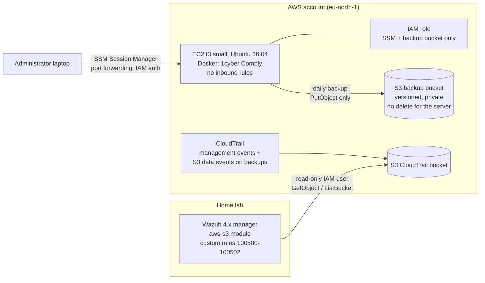

# AWS secure deployment monitored by a self-hosted Wazuh SIEM

A small production-style workload on AWS, hardened by default and watched by a Wazuh SIEM
running outside AWS. The point of the lab: **when something goes wrong in the cloud account,
an on-premises SOC sees it within minutes.**

The workload is [1cyber Comply](https://github.com/ilielucianno/1cyber-comply), an open-source
NIS2 compliance tool I built. The attack scenario tested end to end is the first step of most
ransomware incidents: **an attacker on the server tries to destroy the backups.**

## Result

| Step | What happened | Evidence |
|---|---|---|
| 1 | The server tries to list every bucket in the account and to delete its own backups | AWS returns `AccessDenied` for `s3:ListAllMyBuckets` and `s3:DeleteObject` |
| 2 | CloudTrail records both refused calls (management event and S3 data event) | CloudTrail log files in S3 |
| 3 | Wazuh, running at home, pulls the logs every 10 minutes and applies custom rules | Level 7 alert for the refused listing |
| 4 | The delete attempt on the backup bucket raises a **level 12 alert mapped to MITRE ATT&CK T1490** (Inhibit System Recovery) | `AWS: attempt to delete or tamper with backups in comply-backup-… by …comply-ec2-ssm-role…` |

## Architecture



## Design decisions

**No open ports.** The security group has no inbound rules at all: no SSH, no HTTPS. The server
is administered through AWS Systems Manager Session Manager, authenticated by IAM, with no SSH
keys to leak or rotate. The web application listens on `127.0.0.1` only and is reached through
an SSM port-forwarding tunnel:

```
aws ssm start-session --target <instance-id> --document-name AWS-StartPortForwardingSession \
  --parameters "portNumber=8080,localPortNumber=18080" --region eu-north-1
```

**Least privilege for the workload.** The instance role has `AmazonSSMManagedInstanceCore` and one
inline policy ([iam/comply-backup-s3.json](iam/comply-backup-s3.json)): list, read and write its
own backup bucket. Nothing else. Verified from the server:

```
$ aws s3 rm s3://comply-backup-…/daily/comply-20261106-174329.tar.gz
delete failed: … is not authorized to perform: s3:DeleteObject … because no identity-based policy allows the s3:DeleteObject action
$ aws s3 ls
… is not authorized to perform: s3:ListAllMyBuckets …
```

**Backups an attacker cannot destroy.** The server can add backups but not delete them. Versioning
keeps the previous version if a backup is overwritten. Retention is enforced by an S3 lifecycle
rule (current versions 30 days, noncurrent 7 days), not by the server. The backup itself uses the
SQLite online backup API for a consistent copy of the live database
([scripts/comply-backup.sh](scripts/comply-backup.sh)).

**Instance hardening.** IMDSv2 only, unattended security upgrades enabled, 2 GB swap on a 2 GB
instance, kernel updates applied with a reboot before installation.

**Audit trail.** CloudTrail records management events for the whole account, plus S3 data events
limited to write/delete calls on the backup bucket
([cloudtrail/backup-bucket-data-events.json](cloudtrail/backup-bucket-data-events.json)), which
keeps data-event cost close to zero. Log file validation can prove the logs were not altered.

**SIEM outside the cloud.** Wazuh reads the CloudTrail bucket with a dedicated IAM user that can
only list and read that bucket ([iam/cloudtrail-read-only.json](iam/cloudtrail-read-only.json)).
The access key lives in `/root/.aws/credentials` (mode 600) on the manager. If the AWS account
were compromised, the monitoring and its history would still be intact on separate infrastructure.

## Detection engineering

The stock Wazuh rule for CloudTrail (80202) only raises alerts for event names on a predefined list.
`ListBuckets` and `DeleteObject` are not on it, so the refused calls arrived in Wazuh at level 0 and
were invisible. The custom rules ([wazuh/local_rules.xml](wazuh/local_rules.xml)) attach to the
base rule 80200, which sees every AWS event:

| Rule | Level | Detects |
|---|---|---|
| 100500 | 7 | Any request refused by AWS (credential misuse, reconnaissance, privilege probing) |
| 100501 | 12 | Delete or weakening of the backup bucket: `DeleteObject(s)`, `DeleteBucket`, lifecycle or versioning changes. MITRE ATT&CK T1490 |
| 100502 | 0 | Tuning: the console's background `ListDelegatedAdministrators` call, refused on every page load, found as a false positive on day one |

Module configuration: [wazuh/aws-wodle.xml](wazuh/aws-wodle.xml). No region filter on purpose:
IAM is a global service and its events are logged in `us-east-1`, so a region filter would hide
`CreateUser`, `PutUserPolicy` and `CreateAccessKey`.

## Problems found along the way

- **Installer bug on Ubuntu 26.04.** The 1cyber Comply installer sourced `/etc/os-release`, whose
  `VERSION` variable overwrote the installer's own and turned the git branch into
  `26.04.1 LTS (Resolute Raccoon)`. Fixed upstream by reading os-release in a subshell
  ([commit](https://github.com/ilielucianno/1cyber-comply/commit/2f5aeec)).
- **Data events take effect after a few minutes.** The first delete test ran a minute after the
  data-event selector was saved and was not recorded. Repeated 15 minutes later, it was.
- **New AWS sign-up experience.** Accounts created through the 2026 sign-up flow have no root user
  and a fixed home region; MFA is set on the AWS Builder ID profile. Everything in this lab
  (EC2, VPC, IAM roles, S3, CloudTrail, Systems Manager) works within those limits.

## Repository

```
iam/          IAM policies (instance role, Wazuh reader)
cloudtrail/   advanced event selector for backup-bucket data events
scripts/      daily backup script (cron.daily)
wazuh/        aws-s3 module configuration and custom detection rules
docs/         screenshots
```

## Cost

Runs on the AWS free plan credits: one t3.small instance, two small S3 buckets, one trail with
management events (free) and a handful of data events per day.

## Next steps

- GuardDuty findings into Wazuh (needs advanced account features)
- Alert on root-equivalent activity and new access keys outside working hours
- Infrastructure as code (Terraform) for the whole lab

## Author

Lucian Ilie, Cyprus. Network and security administrator, Wazuh / OPNsense / Linux.
[GitHub](https://github.com/ilielucianno)
